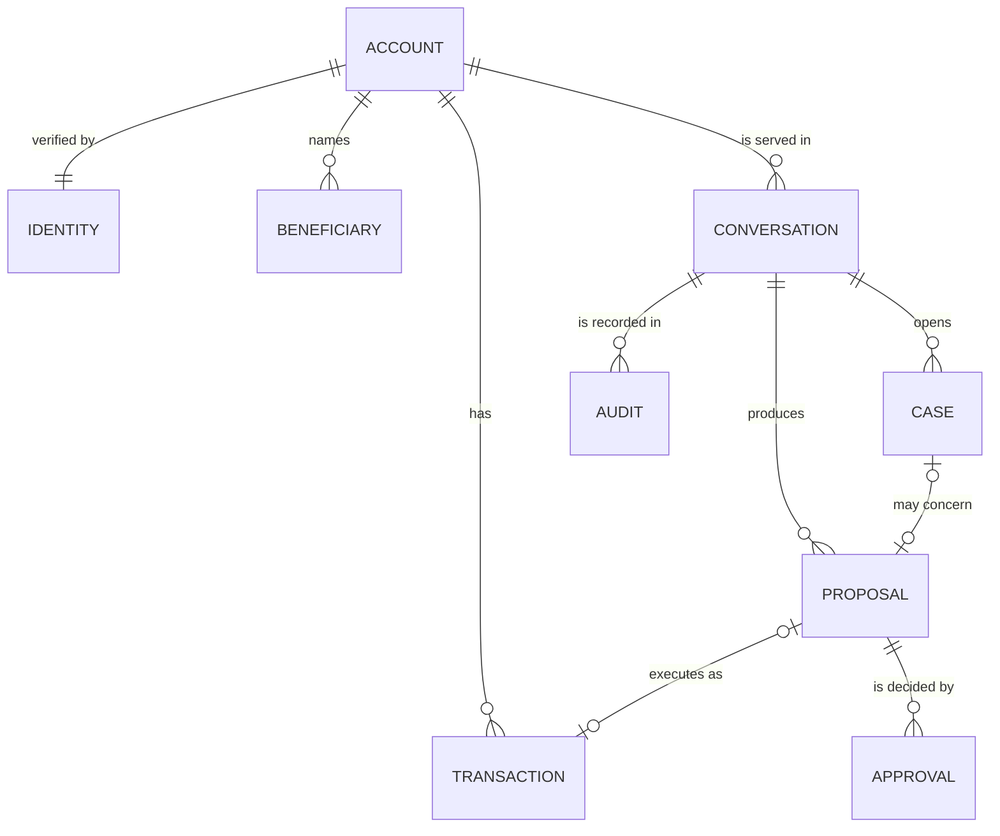
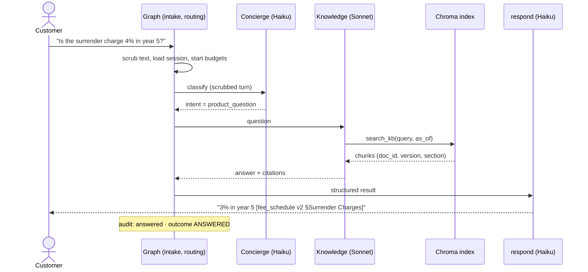
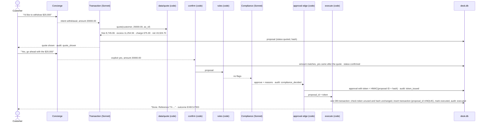
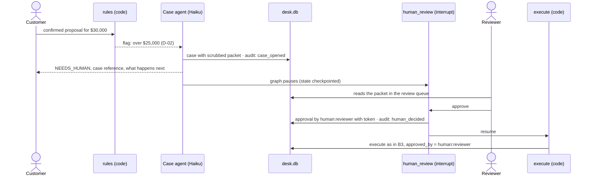
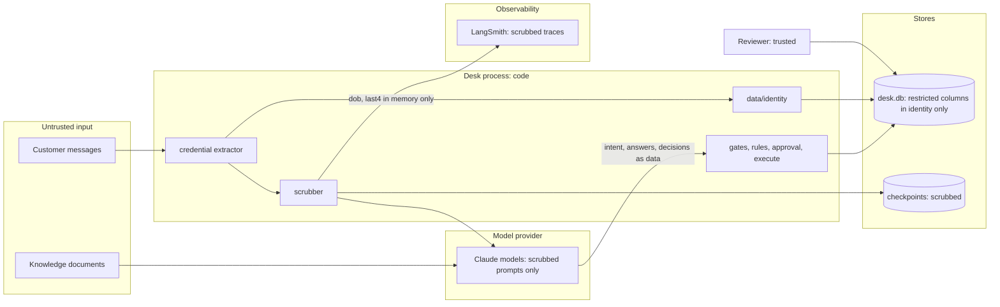
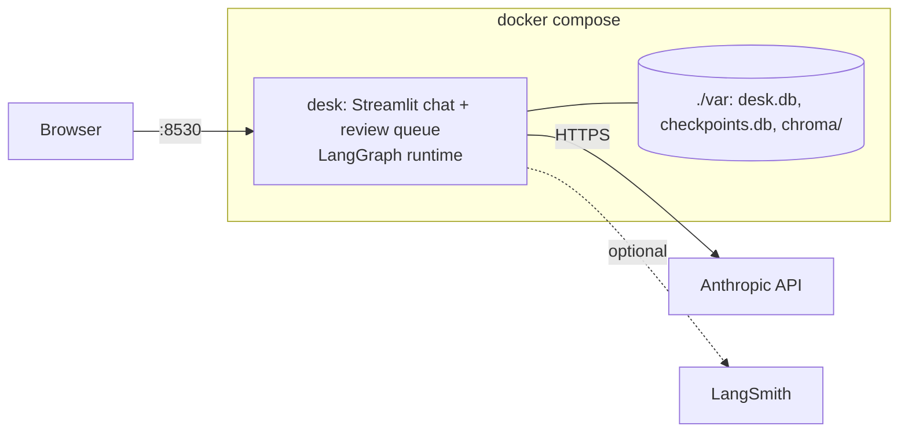

# Architecture: SPR Servicing Desk (v2)

The engineering reference under the [blueprint](blueprint/README.md). The blueprint fixes the shape (the
graph, agent roles, models, who writes which state field). This document adds what the code is built from:
the vocabulary, the data model, the flows, the trust boundaries and the deployment.

Status: **design-time**. At release (R) the `evidence-compiler` agent refreshes it from the code and real runs,
and every difference from this version is called out. Requirement IDs refer to [PRD.md](PRD.md).

## 1. Vocabulary

Every document, table and contract uses these words in exactly these senses.

| Term | Meaning | Identifier |
|---|---|---|
| **Conversation** | One customer session with the desk, from first message to the last. One LangGraph thread, one trace, one set of budgets. "Cost per conversation" and "per-conversation budget" refer to this. | `conversation_id` (= LangGraph `thread_id`) |
| **Turn** | One customer message and the desk's reply to it. Per-turn budgets apply here. | `turn` (1, 2, ...) |
| **Quote** | The figures for one amount, computed by code: allowance remaining, excess, charge, net. | inside a proposal |
| **Proposal** | A quote the customer may confirm, with a hash over the customer, the amount and every figure. | `proposal_id` |
| **Approval** | A Compliance or human decision on one proposal. An approval to execute carries a single-use token bound to the proposal hash. | `approval_id` |
| **Case** | An escalation to a human reviewer, with a case packet. A conversation can open zero or more cases. | `case_id` |
| **Outcome** | The one code a turn ends in: `ANSWERED`, `EXECUTED`, or a PRD §6 failure code. | `outcome` |
| **Restricted field** | Date of birth and SSN digits. Never in a prompt, trace, log, answer or case packet. | — |

## 2. Data model

### 2.1 Entities



### 2.2 Tables in `desk.db` (SQLite)

Money is stored as **integer cents**. All arithmetic is `Decimal` in code with half-up rounding to the cent
(GR-03). Classification: **P** public, **I** internal, **C** confidential (customer data), **R** restricted.

**`accounts`** (lane: data · read by: `account`, `transaction`, `rules`, reviewer UI)

| Column | Type | Class | Notes |
|---|---|---|---|
| `customer_id` | TEXT PK | I | `SPR-1001`, or `SYN-...` for synthetic customers |
| `name`, `email`, `phone` | TEXT | C | Shown only to the verified owner and the reviewer |
| `account_status` | TEXT | I | `active`, `frozen`, `deceased` |
| `gate_a_trusted` | INTEGER (0/1) | I | The starter kit's `identity_verified`: out-of-band trust, never changed by the desk (PG-03) |
| `balance_cents` | INTEGER | C | Current balance |
| `initial_deposit_cents` | INTEGER | C | |
| `contract_start_date` | TEXT (ISO date) | I | Contract year is derived from this and the as-of date |
| `contract_year_stored` | INTEGER | I | Kept only for the data-quality check: stored must equal derived (PG-02) |
| `is_synthetic` | INTEGER (0/1) | I | 1 for every record not in the starter kit |

**`identity`** (lane: data · read by: `data/identity` functions only)

| Column | Type | Class | Notes |
|---|---|---|---|
| `customer_id` | TEXT PK, FK accounts | I | |
| `dob` | TEXT (ISO date) | **R** | Compared in code; never returned |
| `ssn_last4` | TEXT | **R** | Compared in code; never returned |

The only interface is `check_challenge(customer_id, dob, last4) -> bool` and `age_band(customer_id, as_of)`,
which returns a band (`under_59_5`, `59_5_to_79`, `80_plus`), not the date (PG-04).

**`beneficiaries`** (read by: reviewer UI only; the desk never changes them, NG-03)

| Column | Type | Class |
|---|---|---|
| `beneficiary_id` INTEGER PK, `customer_id` FK, `name` C, `relationship` C, `percentage` I | | |

**`transactions`** (lane: data · written by: `execute` only · read by: `transaction`, `rules`)

| Column | Type | Class | Notes |
|---|---|---|---|
| `transaction_id` | TEXT PK | I | Confirmation reference shown to the customer |
| `customer_id` | TEXT FK | I | |
| `proposal_id` | TEXT FK, **UNIQUE**, nullable | I | The idempotency key: one transaction per proposal (FR-09). Null only for seeded history |
| `contract_year` | INTEGER | I | Year the withdrawal counts against (D-05) |
| `gross_cents`, `free_cents`, `excess_cents`, `charge_cents`, `net_cents` | INTEGER | C | Copied from the proposal |
| `approved_by` | TEXT | I | `compliance` or `human:<reviewer_id>`; `seed` for history |
| `executed_as_of` | TEXT | I | The as-of date of execution |
| `is_synthetic` | INTEGER | I | |

**`conversations`**

| Column | Type | Class | Notes |
|---|---|---|---|
| `conversation_id` | TEXT PK | I | Also the LangGraph thread ID and the trace ID |
| `customer_id` | TEXT FK, nullable | I | The session-bound customer; null for an anonymous product question |
| `started_at` | TEXT (UTC timestamp) | I | Wall clock, for operations |
| `as_of` | TEXT | I | The configured business date |
| `gate_b_passed`, `failed_attempts`, `locked` | INTEGER | I | Mirrors the case state for reporting |
| `cost_usd_micros` | INTEGER | I | Running model cost, checked against the per-conversation budget |

**`proposals`**

| Column | Type | Class | Notes |
|---|---|---|---|
| `proposal_id` | TEXT PK | I | |
| `conversation_id` | TEXT FK | I | |
| `customer_id` | TEXT FK | I | |
| `amount_cents` + the four quote figures | INTEGER | C | |
| `rate_bp` | INTEGER | P | Surrender rate in basis points (600 = 6%) |
| `threshold_tier` | TEXT | I | `self_service` or `human` (D-02) |
| `hash` | TEXT | I | SHA-256 over customer, amount, figures, rate, as-of, contracts version |
| `status` | TEXT | I | `quoted` → `confirmed` → `approved` → `executed`, or `voided` / `escalated` |
| `quoted_turn`, `confirmed_turn` | INTEGER | I | GR-17: the yes must come after the quote |

**`approvals`**

| Column | Type | Class | Notes |
|---|---|---|---|
| `approval_id` | TEXT PK | I | |
| `proposal_id` | TEXT FK | I | |
| `approver` | TEXT | I | `compliance` or `human:<reviewer_id>` |
| `decision` | TEXT | I | `approve`, `hold`, `escalate`, `reject` |
| `reasons` | TEXT (JSON) | I | Each reason cites a policy section |
| `token_hmac` | TEXT, nullable | I | Present only for an approval to execute; HMAC-SHA256 of the proposal ID and hash with `APPROVAL_SECRET` (#93) |
| `used_at_turn` | INTEGER, nullable | I | Set on first use; a second use fails (single use) |

**`cases`**

| Column | Type | Class | Notes |
|---|---|---|---|
| `case_id` | TEXT PK | I | The case reference shown to the customer |
| `conversation_id` | TEXT FK | I | |
| `customer_id` | TEXT FK | I | Required by the contract (0.4.0, #80): every case names its customer. A third party in an anonymous session gets no case and is told the owner must contact SPR. The column is still nullable in migration 0002; the contract enforces it at the port |
| `proposal_id` | TEXT FK, nullable | I | |
| `opened_for` | TEXT | I | `CaseReason`: `locked` (D-08), `third_party` (D-09); later bullets add reasons |
| `reasons` | TEXT (JSON) | I | Rule flags and Compliance reasons |
| `packet` | TEXT (JSON) | C | FR-16 fields; scrubbed before it is written |
| `status` | TEXT | I | `open`, `info_requested`, `approved`, `rejected`, `closed` |
| `decided_by`, `decided_at` | TEXT | I | |

**`audit`** (append-only; written by: money-path nodes, `case`, `identity_gate`, `respond`)

| Column | Type | Class | Notes |
|---|---|---|---|
| `audit_id` | INTEGER PK AUTOINCREMENT | I | |
| `conversation_id`, `case_id` | TEXT | I | |
| `turn` | INTEGER | I | |
| `at` | TEXT (UTC timestamp) | I | |
| `node` | TEXT | I | The node that decided |
| `event` | TEXT | I | e.g. `gate_a_refused`, `gate_b_passed`, `locked`, `quote_shown`, `confirmed`, `rule_flagged`, `compliance_decided`, `token_issued`, `executed`, `case_opened`, `human_decided`, `answered`, `refused` |
| `payload` | TEXT (JSON) | I / C | Scrubbed |
| `versions` | TEXT (JSON) | I | Model IDs, prompt versions, policy document versions, contracts version |
| `prev_hash`, `row_hash` | TEXT | I | Hash chain: each row hashes the previous row's hash, so a deleted or edited row shows |

Triggers reject `UPDATE` and `DELETE` on `audit` (PG-10). `python -m agents.audit <conversation_id>` rebuilds a
conversation, and its cases, from these rows alone (FR-25).

### 2.3 Outside `desk.db`

| Store | What | Notes |
|---|---|---|
| `knowledge/*.md` | Knowledge documents, integrator-owned | Front matter: `doc_id`, `version`, `effective_date`, `superseded_by` (optional), `synthetic` (true/false) |
| Chroma (embedded, `var/chroma/`) | One chunk per document section | Metadata on every chunk: `doc_id`, `version`, `effective_date`, `section`, `source_path`. Retrieval filters to the version in force at the as-of date (FR-24) |
| LangGraph checkpoints (`var/checkpoints.db`) | Case state per conversation, for the human-review pause | Holds scrubbed messages only |

## 3. Flows

One diagram per tracer-bullet path. Every flow ends in exactly one outcome per turn and writes the audit
events named on the arrows.

### 3.1 B1: cited product answer



### 3.2 B2: identity and account view

```mermaid
sequenceDiagram
    actor C as Customer
    participant G as Graph (intake)
    participant ID as identity_gate (code)
    participant IDS as data/identity
    participant ACC as account (code)
    participant R as respond
    C->>G: "What's my balance?"
    G->>ID: Gate A for the session's customer
    alt account not trusted (Gate A fails)
        ID-->>R: NOT_PERMITTED, no challenge asked (GR-14)
        R-->>C: "Please contact SPR at 1-800-555-0192"
    else trusted, challenge not yet passed
        ID-->>R: ask for date of birth and last 4 of SSN
        R-->>C: verification request
        C->>G: "1958-03-14, last four 7823"
        G->>G: extract credential candidates from the raw text, then mask them
        G->>ID: candidates (never shown to a model)
        ID->>IDS: check_challenge(customer, dob, last4)
        IDS-->>ID: true / false
        alt passed
            ID->>ACC: read account view
            ACC-->>R: balance, contract year, allowance (no restricted fields)
            R-->>C: "Your balance is $87,450.62"
        else third failure
            ID-->>R: locked; case opened (D-08)
            R-->>C: NOT_PERMITTED with case reference
        end
    end
```

FR-03 at the start (#82): the desk's first reply in a session bound to an untrusted account carries the
notice and the contact number, whatever the turn asked; a product question is still answered. A third
party in an anonymous session gets no case (contracts 0.4.0): there is no account to open one for.

Where the capture runs: at the runner's entry, before the customer turn is appended to the
transcript, so the raw text never enters `ConversationState` (and so never reaches a checkpoint).
The candidates live only in the per-turn context that `identity_gate` reads. A turn with no usable
candidates asks again and does not count as a failed attempt (ADR 0005). `identity_gate` records its
decision in the per-turn `gate` field, and the state itself refuses an account view unless both gates
hold for the bound customer (contracts 0.3.0).

### 3.3 B3: routine withdrawal



### 3.4 B4: human review path



The customer may have left before the reviewer decides. The outcome is recorded on the case. Telling the
customer later (email, portal) is outside this build.

### 3.5 B5: fail closed

```mermaid
sequenceDiagram
    actor C as Customer
    participant G as Graph runner
    participant CO as Compliance
    participant CASE as Case agent
    C->>G: confirmed proposal
    G->>CO: review
    alt Compliance errors or times out
        CO--xG: no decision
        G->>CASE: open case (if the queue is up)
        G-->>C: UNAVAILABLE: nothing was withdrawn; case reference
    else a budget runs out (hops, tool calls, 30 s, $0.10)
        G->>G: stop the turn
        G-->>C: UNAVAILABLE: nothing was withdrawn
    else execution switched off (kill switch)
        G->>CASE: open case
        G-->>C: NEEDS_HUMAN
    end
```

## 4. Trust boundaries



| Boundary | Rule | Requirement |
|---|---|---|
| Customer text → desk | Credential-shaped text is extracted by code and masked before anything else sees it ([ADR 0005](decisions/0005-credentials-captured-by-code.md)) | GR-09, FR-23 |
| Desk → model | Only scrubbed text, the account view (no restricted fields) and documents | GR-09 |
| Documents and model output → desk | Treated as data. Instructions inside them are not followed; routing and authority stay in code | GR-11, NG-09 |
| Desk → traces and checkpoints | Scrubbed before writing | FR-23 |
| `identity` table | Read only through `check_challenge` and `age_band`; values never leave the function | PG-04 |
| Reviewer | Trusted, inside SPR. In this build the review page has no login; production puts it behind SPR's SSO | — |

## 5. Deployment



| Setting | Where | Notes |
|---|---|---|
| `ANTHROPIC_API_KEY` | `.env` (local), GitHub secret (evals) | Product runtime and evals only |
| `LANGSMITH_API_KEY`, `LANGSMITH_PROJECT` | `.env` | Optional; tracing off without them |
| `DESK_AS_OF` | `.env`, default `2024-12-01` | The business clock (D-04) |
| `APPROVAL_SECRET` | `.env` | HMAC key for approval tokens; generated per environment |
| `EXECUTION_ENABLED` | `.env`, default `true` | Kill switch for execution (FR-26) |
| `DESK_VAR_DIR` | `.env`, default `var` (compose sets `/app/var`) | Where `desk.db`, checkpoints and the Chroma index live |
| `DESK_DEMO_LOGINS` | `.env`, default `true` | Seeds the demo passwords (ADR 0007); anything but `true` turns it off |
| `MODEL_MAP` | `agents/config/models.yaml` | Model and effort per role (ADR 0004) |
| Host port | 8530 → container 8501 | Chosen to avoid the other local stacks |

**Production story (slides, not built):** the desk as a container on ECS Fargate behind SPR's SSO; RDS for
the relational store; a managed vector store; secrets in AWS Secrets Manager; durable LangGraph checkpoints in
Postgres; LangSmith and CloudWatch for observability; the pipeline's eval gate in front of every deploy.
