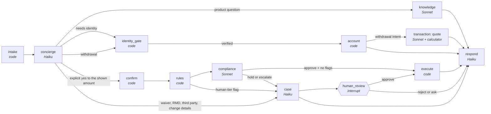

# Blueprint: SPR Servicing Desk (v2)

The design every lane builds against. Requirement IDs refer to [PRD.md](../PRD.md), rules to
[GROUNDING_RULES.md](../GROUNDING_RULES.md), bullets to [PLAN.md](../PLAN.md).
Decisions: [ADR 0003](../decisions/0003-langgraph-code-routed-graph.md) (framework and topology),
[ADR 0004](../decisions/0004-model-per-role.md) (models). A slide version is in `blueprint.html`, published at
https://claude.ai/artifact/JqUdFUhq3BoiMUt2Mh7kWd (private to the owner until shared).

## 1. The shape in one paragraph

A **LangGraph** graph runs one customer case. One LLM, the **Concierge**, reads what the customer wants and
writes the replies. **Code** decides which node runs next. Every money movement follows the same fixed
path: **quote → confirm → rules → Compliance → execute**, or a case for a human. LLMs judge inside a node
(what the customer means, what a document says, whether a request looks coerced). They never choose to
skip a node, and they never hold the authority to move money: code issues and checks that authority.

## 2. The graph



| Node | Kind | What it does | Writes to state |
|---|---|---|---|
| `intake` | code | Loads session context (customer ID, Gate A, as-of date, kill switches), starts budgets | `session`, `budgets`, `switches` |
| `concierge` | LLM, Haiku 5.5 | Classifies intent, extracts amount and confirmation; never answers product or account questions itself | `intent` |
| `identity_gate` | code | Gate A (from the record), Gate B challenge, 3-attempt lockout (D-08) | `session.gate_b`, `session.failed_attempts`, `session.locked` |
| `knowledge` | LLM, Sonnet 5.5 | Retrieves from the knowledge base and answers with citations | `knowledge_answer` |
| `account` | code | Reads the non-restricted account view | `account_view` |
| `transaction` | LLM, Sonnet 5.5 + code calculator | Calls the quote calculator (code computes every figure), builds the proposal, explains it | `quote`, `proposal` |
| `confirm` | code | Accepts only an explicit yes, given after the quote, for the proposal's exact amount (GR-17) | `confirmation` |
| `rules` | code | Threshold, status, waiver-request, full-surrender and age-80+ flags (D-02, D-07) | `rule_flags` |
| `compliance` | LLM, Sonnet 5.5 | Reviews proposal, flags and a scrubbed excerpt for coercion, third parties and confusion; returns approve / hold / escalate with reasons | `compliance` |
| `approval` | code (inside `compliance`'s exit edge) | Issues the approval token only if the decision is `approve` **and** there are no rule flags | `approval_token` |
| `execute` | code | Checks the token against the proposal hash, executes once (idempotency key), writes transaction + audit in one DB transaction | `execution` |
| `case` | LLM, Haiku 5.5 | Writes the case packet for the reviewer (FR-16) | `case_ref`, `case_packet` |
| `human_review` | LangGraph interrupt | Pauses the case until a reviewer approves, rejects or asks for information | `human_decision` |
| `respond` | LLM, Haiku 5.5 (Concierge prompt) | Writes the customer reply from the structured outcome; one outcome code per turn (GR-20) | `reply`, `outcome` |

**Routing is code.** Edges are functions of state (`intent`, `session`, `rule_flags`, `compliance`,
`switches`), not model choices. The only LLM output that steers routing is the Concierge's `intent`, and
every intent still passes through the same gates.

## 3. Agents, models and tool scope

Each agent's tools are registered for its role only. Calling another role's tool is refused in code and
logged (FR-22).

| Agent | Model (start) | Effort | Tools it may call | It never |
|---|---|---|---|---|
| Concierge | Haiku 5.5 | low | `verify_identity` (passes credentials to the identity gate, never sees stored values) | quotes, answers product facts, approves |
| Knowledge | Sonnet 5.5 | medium | `search_kb` | reads account data |
| Transaction | Sonnet 5.5 | medium | `get_account`, `quote`, `propose` | approves its own proposal, executes |
| Compliance | Sonnet 5.5 | high | `get_policy` (read-only policy sections) | executes, edits a proposal |
| Case | Haiku 5.5 | low | `create_case` | decides the case |

`execute` is not a tool any agent can call. Only the `execute` node runs it, after the approval edge.
The starting models are confirmed or changed by the model-per-role evals (ADR 0004).

## 4. Case state (single writer per field)

Typed in `contracts/state.py`. Every field has exactly one writer node; a write from any other node is a
contract violation and fails the case closed (FR-19).

| Field | Writer | Notes |
|---|---|---|
| `case_id`, `session`, `as_of`, `switches`, `budgets` | `intake` (budgets updated by the runner) | `session` holds Gate A, never DOB or SSN |
| `session.gate_b`, `failed_attempts`, `locked` | `identity_gate` | |
| `intent` | `concierge` | Intent, amount, explicit-yes flag |
| `account_view` | `account` | Balance, contract year, age band, allowance remaining. No restricted fields |
| `knowledge_answer` | `knowledge` | Answer text plus citations (`doc_id`, `version`, `section`) |
| `quote`, `proposal` | `transaction` | `proposal.hash` covers customer, amount and every quote figure |
| `confirmation` | `confirm` | Amount and turn number of the explicit yes |
| `rule_flags` | `rules` | |
| `compliance` | `compliance` | Decision and reasons |
| `approval_token` | approval edge | HMAC over `proposal.hash`, single use |
| `human_decision` | `human_review` | Reviewer, decision, time |
| `execution` | `execute` | Transaction ID, idempotency key |
| `case_ref`, `case_packet` | `case` | |
| `reply`, `outcome` | `respond` | One PRD §6 code, or `ANSWERED` / `EXECUTED` |
| `versions` | `intake` | Model, prompt and policy-document versions, copied into every audit row |

## 5. Data

| Store | What | Who can read it |
|---|---|---|
| `desk.db` (SQLite) · `accounts` | Account record without restricted fields | `account`, `transaction`, `rules` |
| `desk.db` · `identity` | DOB and SSN last 4 (PG-04) | `identity_gate` only, by function call; never returned |
| `desk.db` · `transactions` | Withdrawals (seeded history for D-05) | `transaction`, `execute` |
| `desk.db` · `proposals`, `cases` | Proposals and their hashes; case packets | money-path nodes, reviewer UI |
| `desk.db` · `audit` | Append-only (triggers block UPDATE and DELETE) | `execute`, `case`, the audit-rebuild command |
| `knowledge/` → Chroma | Versioned markdown documents with front matter (`doc_id`, `version`, `effective_date`) chunked by section | `knowledge`, `compliance` (policy sections) |

- **Clock:** one configured as-of date, 2024-12-01 (D-04). Contract year and age are derived from it.
- **Scrubber:** one function removes restricted values from any text before it reaches a prompt, a trace,
  a log or a case packet. Unit-tested (EVAL_SPEC §4).
- **Knowledge documents** live in `knowledge/` (integrator-owned, protected from agent PRs): the three
  starter documents, the two new policy documents (large-withdrawal and vulnerable-customer, PRD O-02),
  and a superseded fee-schedule version for the versioning test (B4).
- **Embeddings:** local sentence-transformers; Chroma embedded. No network at test time.

## 6. Prompt layout for caching

From the cost model: 83% of a withdrawal's input is cacheable, so every agent's request is built
stable-first, and the order never changes:

1. **Tools:** fixed list per role, sorted, byte-identical across cases.
2. **System prompt:** a versioned file in `agents/prompts/`, no dates, IDs or customer data.
3. **Session context:** one message with Gate A status and the as-of date.
4. **Conversation:** earlier turns, then the newest turn.

A cache breakpoint sits after the system prompt and after the latest completed turn. Updates during a
case (a lock, a kill switch) go in as new messages, never as edits to the system prompt.

## 7. Guards, budgets and switches

| Guard | Where | Requirement |
|---|---|---|
| Both identity gates before any account node | `identity_gate` + edges | FR-02, GR-12 |
| No credentials asked on an untrusted account | `identity_gate` | FR-03, GR-14 |
| Quote, explicit yes and token before execute | `confirm`, approval edge, `execute` | FR-08, GR-16 to GR-18 |
| Compliance cannot approve a flagged proposal | approval edge | FR-11 |
| One withdrawal per proposal | `execute` (idempotency key) | FR-09 |
| Tool scope per role | tool registry | FR-22 |
| Contract validation on every state write | runner | FR-19 |
| Budgets: 8 hops, 12 tool calls, 30 s per turn; $0.10 per case | runner (LangGraph recursion limit, counters, usage) | FR-20, D-10 |
| Fail closed when Compliance or the queue is down | edges | FR-21, GR-21 |
| Kill switch on execution | `switches` read by edges | FR-26 |

## 8. Observability and audit

- **Tracing:** LangSmith, one trace per case (`case_id` as the thread), with model, prompt version, tokens,
  cost and latency per node. Text is scrubbed before it is traced.
- **Audit:** separate from traces, in `desk.db`. Every node that decides anything writes one row with the
  versions in force. `python -m agents.audit <case_id>` rebuilds the case (FR-25).

## 9. Runtime

| Service | In `compose.yaml` | Port (host) |
|---|---|---|
| `desk`: Streamlit chat UI and the reviewer queue page | B1 (chat), B4 (queue) | 8530 |
| `checks`: the CI check suite in the same image | exists | none |

LLM calls go through `ChatAnthropic` (langchain-anthropic) so LangSmith traces them. Two details to verify
in B1 before relying on them: per-request `effort`, and `cache_control` placement through ChatAnthropic.

## 10. Folder layout (lane ownership and the money path)

```
contracts/             integrator   state.py, messages.py, tools.py, outcomes.py
knowledge/             integrator   versioned knowledge documents
data/                  data lane
  store/                            schema, migrations, seed
  identity/            money path   restricted fields, challenge check
  quote/               money path   the calculator (FR-05, D-05)
  ledger/              money path   transactions, idempotent execute, append-only audit
  knowledge_index/                  ingestion and retrieval
  synthetic/                        synthetic customers and history
  clock.py, scrub.py
agents/                agents lane
  graph.py                          the LangGraph graph and routing functions
  nodes/                            concierge, knowledge, respond, case
  nodes/transaction.py money path
  nodes/compliance.py  money path
  gates/               money path   identity gate, confirm, rules engine, approval token
  tools/                            registry and scope check
  prompts/                          versioned prompt files
  ui/                               Streamlit chat and reviewer queue
evals/, redteam/       quality lane
```

The money-path paths above are the list the mechanical guard in ADR 0002 will use.

## 11. Bullets against this design

| Bullet | Nodes and stores it brings to life |
|---|---|
| B1 | `intake`, `concierge`, `knowledge`, `respond`; `knowledge/` + index; tool registry; contract validation; tracing; one audit row; chat UI |
| B2 | `identity_gate`, `account`; `identity` table split; scrubber; clock |
| B3 | `transaction`, `confirm`, `rules`, `compliance`, approval edge, `execute`; transactions, proposals, audit triggers |
| B4 | `case`, `human_review`; cases table; reviewer UI; superseded document version |
| B5 | Budgets, fail-closed edges, kill switches, D-07 signals; audit rebuild command |
